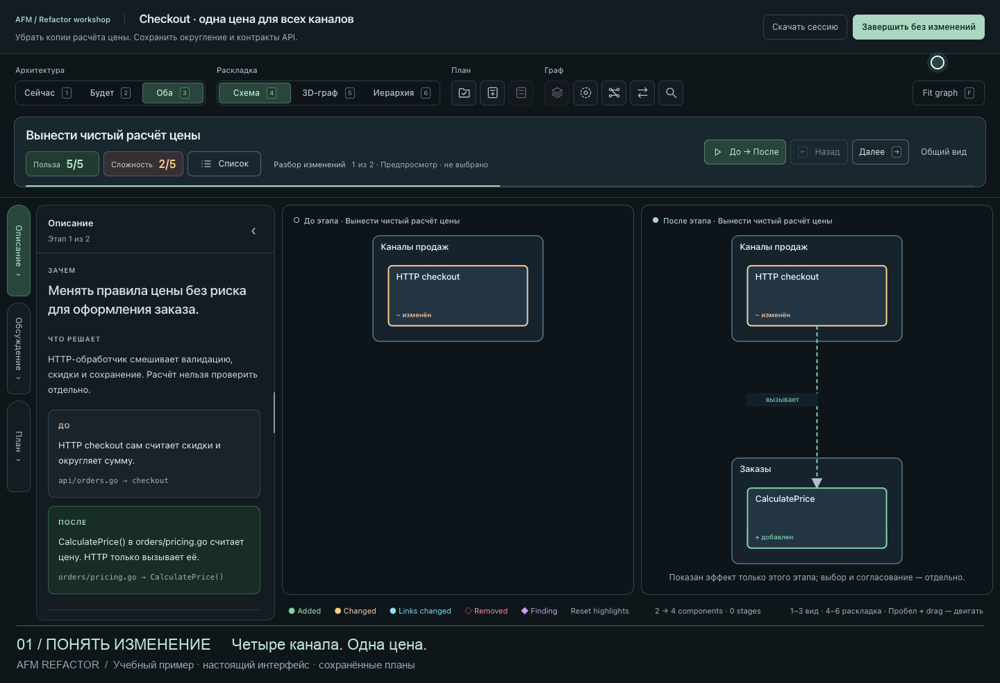

# Refactor

An AFM pipeline for understanding a complex project and agreeing on a
refactoring plan before changing code.

Two independent architects inspect the source and Strictacode evidence, merge
their findings, rank proposals by benefit and ease, and explicitly approve the
same analysis packet. The workshop lets you inspect before/after diagrams,
hierarchies or 3D graphs, discuss proposals, and assign selected stages to named
plans. The final stage exports the approved plans and an offline report.

**This pipeline does not implement the refactoring.** Approval exports plans;
it does not authorize changes to application source or create commits.

## Watch the workshop



An already open workshop: inspect before/after changes, ask about rounding,
create a plan, preview the next change, rotate the 3D graph, then save two plans.
The final frame shows the [actual exported plans](docs/demo-plans/README.md):
shared pricing first, channel migration second.

The checkout architecture is illustrative. The discussion replays a real Codex
response to that fixture; the interface, selection, approval and plan export
are real. [Capture source and reproduction instructions](https://github.com/akopichin/afm-pipelines/tree/main/demo/refactor).

## Requirements

- AFM with worktrees, team agents, script stages, and a managed browser. The
  package is tested with AFM 2.0.2; this is not a blanket compatibility guarantee
  for older versions.
- A Git target project and Node.js 18+ in the execution environment.
- A browser-capable coordinator/workshop client and the two configured
  architect profiles from [config.example.yaml](config.example.yaml).
- Two independent architect agents. Defaults are Claude Opus 5.5
  (`claude-opus-5-5`) and GPT-6.1 Sol (`gpt-6.1-sol`) with `xhigh` reasoning.
  The installer supports different models, including the same model for both
  independent roles. It updates dispatch and `bindings.json` together.

The Docker configuration example forwards an environment reference for Claude
authentication and uses Codex's mounted authentication state. It contains no
secret values. Native execution requires equivalent available client commands;
Docker wrapper names are not native executables.

## Install and run

Recommended: use the catalog's [installer](https://github.com/akopichin/afm-pipelines/blob/main/docs/installer.md), directly or
through AFM's `afm-pipelines` skill. It offers models, settings and optional skills
and validates the generated profiles. The steps below describe a manual install
with the bundled default models; change dispatch and bindings together if
customizing without the installer.

Copy this entire directory to `pipelines/refactor/` inside the target project.
Do not copy just `flow.yaml`, and do not launch an external catalog checkout
against another project: its files may be unavailable in Docker or a worktree.

Merge [config.example.yaml](config.example.yaml) into `.afm/config.yaml` without
overwriting other settings. Enable the managed browser and configure provider
authentication. From the target project's root:

```sh
afm validate pipelines/refactor/flow.yaml
AFM_COLLABORATION=1 AFM_BROWSER=1 afm run pipelines/refactor/flow.yaml \
  --worktree refactor --port 3434 --idle-timeout 24h
```

No global skill installation is required for this flow: it reads the bundled
[Strictacode skill](skills/strictacode/SKILL.md) by explicit path. The catalog
installer also offers project-local discovery copies for the chosen clients.
The prebuilt interface works without `npm install` at runtime.

The worktree contains the application revision being analyzed. Uncommitted
application changes in the main checkout are not automatically copied into it.
The package hook can find a newly installed package in the main checkout if it
is absent from the worktree's revision.

## Update an installed pipeline

After the new catalog commit is pushed, ask the `afm-pipelines` skill in the
**target project**:

> Update the installed refactor pipeline from akopichin/afm-pipelines to the
> latest version. Preserve my model bindings, settings and skills. Do not run it.

The installer checks managed files before replacing them and preserves saved
choices when no new options are supplied. Resolve local managed-file edits
before updating. There is no need to reinstall AFM or its skills just to update
this package. Start the next run with the same command. Existing runs keep
their frozen toolkit; an update does not rewrite a running workshop.

## Run isolation and outputs

`scope` atomically freezes the complete runtime package into
`<run-dir>/scope/toolkit/`, with hashes in `.snapshot.json`. All later stages use
that snapshot. Retrying verifies and reuses it, even after the installed package
changes. Source and UI paths are resolved relative to the frozen package, not
the shell's working directory.

The stages are `scope → analyze → validate-analysis → workshop → plan`.
The installed package is excluded from the application source receipt; it is
tracked separately by the toolkit snapshot. Keep it out of architecture scopes
and report any analyzer coverage limitations rather than treating tooling as
application code.

Working reports and checkpoints stay in AFM stage directories. Approved output
is exported to `docs/superpowers/refactors/<run-directory-name>/` in the run's
worktree: named Markdown plans, execution order/dependencies, architecture
snapshots, decisions, and an offline HTML report. Save or commit these artifacts
before clearing the worktree. The pipeline does not commit them for you.

See [the workshop guide](docs/workshop.md) for controls, keyboard shortcuts,
discussion, plan grouping, source validation, recovery, and detailed contracts.

## Try the UI without model calls

From this package directory:

```sh
node scripts/workbench.mjs build \
  --input examples/example.json --output /tmp/refactor-demo/workbench.html
node scripts/workbench.mjs start --session /tmp/refactor-demo --port 18080
# Open http://127.0.0.1:18080; when finished:
node scripts/workbench.mjs stop --session /tmp/refactor-demo
```

This uses synthetic sample data. Agent replies require a real AFM run.

## Development

```sh
npm ci
npm test
npm run test:browser
npm run build
```

Checks require Node.js 22+. Config validation also requires the `afm` executable
(`AFM_BIN` overrides its location). Browser checks use an isolated headless
Chrome through CDP; set `CHROME_PATH` if Chrome is not in the macOS default path.
Tests do not launch model agents or require provider credentials.

After changing graphics modules under `ui/`, rebuild and include
`ui/vendor/graph.js` and `ui/vendor/LICENSES.txt`. Build dependencies are pinned
in `package-lock.json`; the builder installs them in a temporary directory and
does not modify the analyzed project's dependencies.

`pipeline.yaml` describes the package and its setup requirements for tooling;
it is not an AFM flow configuration. Use the catalog helper described in [the installer guide](https://github.com/akopichin/afm-pipelines/blob/main/docs/installer.md).
